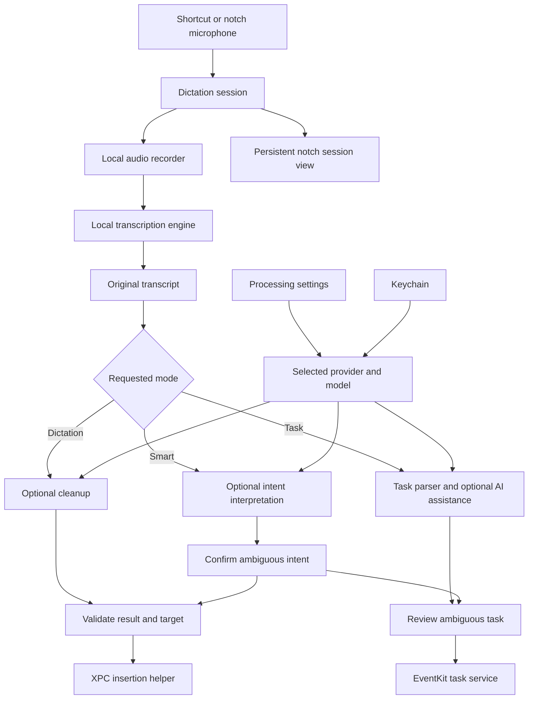

# HeyNotch development roadmap

Updated: 5 November 2026
Status: Phases 0–5 and the subsequently requested meeting extension (5A) are implemented locally. Meeting behavior and its separate live-call acceptance checks are recorded in [MEETINGS.md](MEETINGS.md). Debug and universal Release builds pass; signed TextEdit insertion, local speech-model runs, and real Reminders saves/edits/Undo have been exercised. Provider live requests, the full device/application matrix, second-device sync, and macOS 14 runtime validation remain open release gates. See [Phases 1–5 implementation and verification](PHASES_1_5.md) and the [Phase 0 record](PHASE_0.md).

HeyNotch will let a user hold a shortcut, speak, and either insert text into the current application or create an Apple Reminder. The notch will show recording, progress, results, and recoverable errors. Optional AI processing will use the user's own **Claude, OpenAI, or OpenRouter API key and explicitly selected model**.

This roadmap covers the settings experience, provider integrations, application architecture, delivery sequence, and acceptance checks. Its first release prioritizes dependable dictation, clear control over processing, and tasks that remain accessible when AI is unavailable.

## Product decisions

| Area | Decision |
|---|---|
| Speech recognition | Local WhisperKit first. Voice settings select the speech model, microphone, and language. |
| Text processing | A separate Processing pane offers Claude (Anthropic), OpenAI, and OpenRouter. All three are required for the first provider milestone. |
| Provider selection | One active processing provider and one selected model for that provider. Users can store configurations for all three and switch between them. |
| Credentials | Store API keys in macOS Keychain. Store provider and model preferences separately from credentials. |
| Default behaviour | AI processing starts off. Plain dictation and explicitly requested tasks remain usable without a cloud key. |
| Processing scope | Cleanup, task interpretation, and later optional Smart mode operate on the transcript. Choosing a processing provider does not upload microphone audio or change the speech engine. |
| Routing | Explicit Dictation and Task modes ship first. Smart mode is a later, optional feature. |
| Task storage | Apple Reminders through EventKit, including reminders without due dates. iCloud sync depends on the chosen account/list and device setup. |
| Data destination | Requests go directly from the Mac to the selected provider. OpenRouter may route to an underlying model host under its routing policies. |
| Model choice | Discover current models, retain the exact selected ID, and show compatibility honestly. Never silently replace the user's model. |
| Release scope | All repository actions stay within `WOLFIEEEE/HeyNotch`. Preserve the licensing and attribution requirements in `AGENTS.md`. |

Apple SpeechAnalyzer, Foundation Models, and Ollama remain possible later additions. They do not replace or delay the three requested API providers. A separate notes feature is deferred until its storage, search, and retrieval behaviour are defined.

## Current starting point

The baseline reviewed on 4 November 2026 at commit `8278c60` builds successfully as an unsigned Debug app with Xcode 26.6 on this Mac. The existing Python suite has 38 passing tests and one failing rename assertion. This establishes a buildable starting point, not verification of microphone access, cross-app insertion, or cross-device sync.

| Existing component | Reuse and required change |
|---|---|
| `HeyNotch/Shortcuts/ShortcutConstants.swift` | Add dictation and task shortcuts to the existing KeyboardShortcuts integration. |
| `HeyNotch/HeyViewCoordinator.swift` | Add persistent session presentation. Existing sneak peeks time out and gate non-music content on HUD replacement. |
| `HeyNotch/ContentView.swift` and `components/Tabs/TabSelectionView.swift` | Add dictation presentation and the Tasks tab without disrupting music, shelf, and calendar views. |
| `HeyNotchXPCHelper/` and `HeyNotch/XPCHelperClient/` | Prove insertion through the unsandboxed helper. Keep the duplicated XPC protocol declarations synchronized or share one source between targets. |
| `HeyNotch/Providers/CalendarServiceProviding.swift` | Extend EventKit access for task creation, editing, completion, deletion, and undated reminders. |
| `HeyNotch/models/EventModel.swift` | Keep calendar events separate from the new task model; the current event model requires dates. |
| `HeyNotch/components/Settings/SettingsView.swift` | Add Voice, Processing, and Tasks destinations using the existing native settings structure. |
| `HeyNotch/models/Constants.swift` | Add non-secret settings and migration defaults. |
| `HeyNotch/components/Onboarding/OnboardingView.swift` | Reuse existing Accessibility onboarding and add microphone/model readiness. |

The baseline also needs these corrections: remove the upstream Homebrew publication path, align CI with the supported Xcode toolchain, fix contradictory test expectations, add modern EventKit usage descriptions, and audit the claimed macOS 14 support against bundled binaries. Phase 0 owns these changes.

## Processing settings specification

### Screen structure

Use a native grouped form consistent with the existing Settings window. The visible order should be:

1. **AI processing** switch with a short explanation of what processing changes.
2. **Provider** picker: Claude (Anthropic), OpenAI, OpenRouter.
3. **API key** section for the selected provider, with Save, Verify key, Replace, and Remove actions.
4. **Model** section with search, model selection, Refresh models, and Test model.
5. **Processing behaviour** with cleanup style, task assistance, and failure behaviour.
6. **Advanced** options for supported model controls and account context.

Show an active summary such as **OpenRouter · [selected model name]**. The model detail row must also expose its exact API ID. Use plain status messages: Key saved, Key verified, Models loaded, Model tested, Access restricted, or Offline. These describe different checks and must not be collapsed into a single green success indicator.

### Provider and credential behaviour

- [ ] A user can configure any one provider without entering keys for the others.
- [ ] Each provider remembers its own key reference, selected model ID, supported tuning options, and model verification status across launches.
- [ ] Switching providers restores that provider's configuration. A model selected under OpenRouter is not treated as a direct OpenAI or Claude model.
- [ ] Opening the settings screen or choosing a provider does not start inference or enable transcript uploads.
- [ ] Save keys only through a dedicated Keychain service. Never put them in Defaults, exported settings, model caches, logs, analytics, crash attachments, or the XPC helper.
- [ ] Display masked credentials. Reveal requires an explicit action and ends when the user leaves the field or pane. Clear temporary edit buffers after saving or cancelling.
- [ ] A replacement key is committed only after Keychain storage succeeds. Connectivity verification is a separate result; users can save a key while offline.
- [ ] Removing an active key cancels pending processing and retains any available original transcript. Removal in HeyNotch does not claim to revoke the key at the provider.
- [ ] Show Keychain access errors rather than reporting that a key was saved when storage failed.
- [ ] Provide a provider-specific link to create/manage an API key and explain that API requests use that provider's account and billing.

Planned Keychain namespace: service `com.wolfieeee.heynotch.processing`, accounts `anthropic`, `openai`, and `openrouter`. Use local, non-synchronizing generic password items with an access policy suitable for the signed app. Test persistence and permission behaviour across development and signed builds. Apple provides [Keychain services](https://developer.apple.com/documentation/security/keychain-services) for credential storage.

Non-secret account context, such as a required Claude workspace or an optional OpenAI project, belongs in that provider's settings. Changing key or account context invalidates the corresponding cached access and model-test results.

### Live model discovery

| Provider | Discovery and authentication | Processing interface | Picker behaviour |
|---|---|---|---|
| Claude (Anthropic) | Authenticated `GET https://api.anthropic.com/v1/models`; follow pagination. Use the documented authorization, pinned API-version header, and workspace context when required. | `POST /v1/messages` | Show provider display names, exact IDs, lifecycle state, and available capability metadata. |
| OpenAI | Authenticated `GET https://api.openai.com/v1/models` using the saved key and applicable project context. | Prefer `POST /v1/responses`. Add a same-provider Chat Completions path only for models explicitly documented and tested to require it. | Model listing supplies basic identity/access information, not a complete capability catalogue. Combine it with maintained capability metadata and an explicit model test. |
| OpenRouter | Verify the credential with `GET https://openrouter.ai/api/v1/key`; prefer authenticated `GET /api/v1/models/user` for the account-filtered catalogue. Use `/api/v1/models` for general metadata where needed. | `POST /api/v1/chat/completions` | Show the model name and complete namespaced ID, supported parameters, context limits, and price metadata when present. |

Endpoint references: [Claude models](https://platform.claude.com/docs/en/api/models/list), [Claude authentication](https://platform.claude.com/docs/en/api/overview#authentication), [OpenAI models](https://developers.openai.com/api/reference/resources/models/methods/list), [OpenRouter key verification](https://openrouter.ai/docs/api/api-reference/api-keys/get-current-api-key), [OpenRouter account-filtered models](https://openrouter.ai/docs/api/api-reference/models/list-models-filtered-by-user-provider-preferences-privacy-settings-and-guardrails), and [OpenRouter model metadata](https://openrouter.ai/docs/api/api-reference/models/list-all-models-and-their-properties).

Discovery requirements:

- [ ] Fetch models after the user requests verification/refresh, and refresh stale metadata when a configured Processing pane is opened. Do not query every saved provider at application launch.
- [ ] Complete every page before declaring the catalogue complete; deduplicate exact IDs and retain the existing selection during refresh.
- [ ] Search by display name, ID, and model publisher where available. Clearly separate selected, compatible, unverified, deprecated, and unsupported entries.
- [ ] Offer all applicable text-generation candidates, not a short hardcoded brand list. Known image-only, embedding-only, moderation-only, and audio-only models are ineligible for transcript processing.
- [ ] Represent capability support as supported, unsupported, or unknown. A new model must not be rejected merely because its ID is absent from a bundled list.
- [ ] Provide **Enter model ID manually** for newly released models, restricted discovery permissions, and account-specific models. Validate a manual choice against the appropriate processing endpoint before marking it tested.
- [ ] Distinguish inability to list models from an invalid credential. A key can have narrower permissions than the catalogue requires.
- [ ] Keep a local cache with a last-refresh timestamp, scoped to provider and credential/account revision. Proposed freshness window: 24 hours, with explicit Refresh available at any time.
- [ ] Discard stale asynchronous results after provider/key/account changes. One provider's response must never populate another provider's picker.
- [ ] If the selected model disappears, retain its ID and show its status. Never auto-select the first model or change to a more expensive model.
- [ ] Label cached data while offline. Catalogue presence, cache freshness, and a previous successful test are not promises of current access or billing balance.
- [ ] Preserve exact aliases or snapshot IDs as selected. Explain that provider-managed aliases can change behind a stable name; do not automatically upgrade pinned snapshots.

For OpenRouter, the complete namespaced ID is the selection boundary. Automatic routers, presets, and random-model aliases are excluded from the initial picker because they cannot promise a fixed chosen model. Routing among hosts for that same model is distinct from changing the model.

### Verification and model controls

**Verify key** checks authenticated access and loads models where permitted. **Test model** sends a small, fixed sample to the selected model and reports generation success, elapsed time, and any supported structured-output capability it actually exercised. It never sends clipboard content, a real transcript, or open-document text. The button carries a short note that the test uses API credits.

A successful catalogue lookup must not be presented as a successful inference test. A billing error must not be presented as an invalid key. Store the time and configuration revision of each successful test; invalidate it when the key, model, account, or relevant request settings change.

| Setting | Initial behaviour |
|---|---|
| Cleanup style | Off, Light, or Formal. Off avoids a cleanup request. Light is the default after the user enables cleanup. |
| Task assistance | Optional interpretation of an explicitly requested task; deterministic parsing remains available. |
| Smart mode | Shown only when Phase 6 is implemented and its evaluation gate passes. |
| Output limit | Bound generation for the operation; respect the selected model's parameter names and limits. Do not truncate input silently. |
| Reasoning / effort | Show only controls supported by that model and endpoint. Default to a documented low-latency setting when available. |
| Temperature | Advanced and only when supported; never send unsupported generic parameters to every provider. |
| Response wait limit | A conservative default, initially 15 seconds, tunable after measurement. Show progress and allow immediate cancellation. |
| Processing failure | Default: retain the original and offer Use original, Retry, or Copy. An explicit preference may allow original-text insertion only after target revalidation. |
| Price information | Show current provider metadata when available, with units and freshness. Otherwise link to provider pricing; do not invent prices or claim an exact account bill. |

### Provider request contracts

Use separate adapters behind a common processing interface. An OpenRouter-compatible request body must not be reused blindly for direct Claude or OpenAI calls.

- **Claude:** encode Messages requests, use a tested API version, honor workspace requirements, and collect text blocks while handling refusal and token-limit stop reasons. Where supported, use `output_config.format` for structured results. [Messages](https://platform.claude.com/docs/en/api/messages/create) and [structured outputs](https://platform.claude.com/docs/en/build-with-claude/structured-outputs).
- **OpenAI:** use Responses with `store: false` for these stateless transformations. Extract final text from typed output items instead of assuming the first output item contains text. Use `text.format` for supported structured results and handle refusal/incomplete responses. The storage flag does not promise zero provider retention. [Responses migration guide](https://developers.openai.com/api/docs/guides/migrate-to-responses) and [structured outputs](https://developers.openai.com/api/docs/guides/structured-outputs).
- **OpenRouter:** send the exact selected model ID. For structured processing, request `response_format` only on compatible models and set `provider.require_parameters: true`. Do not submit a fallback model array. Respect account privacy restrictions; offer stricter host-policy options only with a clear explanation of availability effects. [Structured outputs](https://openrouter.ai/docs/guides/features/structured-outputs) and [provider routing](https://openrouter.ai/docs/guides/routing/provider-selection).

A text model without reliable structured output may still support cleanup. Task interpretation and Smart mode require validated structured results or must fall back to deterministic parsing/review. Valid JSON alone does not establish that a task or date is correct.

Use HTTPS endpoints owned by the chosen provider and reject credential-bearing redirects to other hosts. Do not expose arbitrary base URLs in the first release. OpenRouter's internal host routing must not be described as direct communication with the model publisher; where a user pins a host, enforce its documented routing controls and do not silently relax them.

### Data and failure behaviour

The Processing pane explains: **“Your transcript is sent to the selected provider for processing. Audio stays on this Mac.”** Send only the transcript, the requested operation/style, and necessary locale/time context. Foreground-app context is limited to an app identifier and requires a separate setting; document contents, screenshots, and clipboard data are excluded.

| Condition | Required response |
|---|---|
| Missing or rejected key | Show a credential-specific recovery action; retain the transcript. |
| Restricted model/list/workspace access | Explain the restriction; allow account-context correction or manual model selection where appropriate. |
| Insufficient credit or quota | Report the billing/quota issue without treating it as a bad key. |
| Rate limiting | Honor retry timing within a bounded wait; expose Retry and Use original. Avoid a retry loop. |
| Offline, timeout, or provider failure | Preserve the original and apply the selected failure preference. Do not switch to another saved provider. |
| Retired or inaccessible selected model | Keep the choice visible and ask the user to select/test a replacement. |
| Malformed, empty, refused, or truncated result | Do not paste an error body or create a task. Offer the original or review. |
| Cancel, provider change, model change, or key removal | Cancel pending processing, invalidate the request generation, and ignore late results. Never resend automatically. |
| Focus changed before insertion | Retain the result and offer Copy/retry in the intended field. |

Metadata fetches may use bounded retries. Generation retries require care because a lost response can still represent a billed request; do not automatically replay a timed-out generation after it may have reached the provider. Cancellation stops HeyNotch from acting on a reply; an already transmitted request may still be processed or billed by the provider. A per-session operation ID prevents duplicate insertion or reminder creation even when callbacks arrive late.

Keep raw audio ephemeral by default. Keep the most recent recoverable transcript in memory until it is used, dismissed, or the app exits. Meeting history is now an opt-in feature with Clear history, a 30-day retention limit, and at most 50 sessions; dictation history remains a later addition. Logs contain operation state, provider/model identifiers, timing, and sanitized error categories, without credentials or transcript bodies.

## Application architecture



The arrows from Smart mode represent user-selected actions after ambiguity is resolved. Explicit dictation cannot create reminders, and an explicit task session cannot paste into an unrelated application. High-confidence deterministic task parsing may save immediately with an undo action; uncertainty requires review.

### Responsibilities and data contracts

| Component | Responsibility |
|---|---|
| `DictationManager` | Own session state, mode, cancellation, original/result text, and destination context. Publish UI state on the main actor. |
| `AudioRecorder` | Capture audio and levels off the UI thread; handle device changes and return samples with format metadata. |
| `TranscriptionEngine` | Prepare/download/load/unload models, transcribe, and cancel. Resample inside the engine boundary when required. |
| `ProcessingSettingsStore` | Persist non-secret provider/model preferences and revision identifiers. |
| `ProviderKeyStore` | Read/write/delete provider credentials through Keychain. |
| `ModelCatalogService` | Fetch, paginate, normalize, cache, search, and assess model metadata. |
| `ProcessingProvider` adapters | Encode provider-specific requests and normalize successful output/errors/usage. |
| `ProcessingCoordinator` | Apply mode/style rules, deadline/cancellation, configuration snapshots, and output validation. |
| `TextInsertionService` | Coordinate the app/helper boundary, target checks, clipboard ownership, and meaningful insertion outcomes. |
| `TaskParser` and `TaskService` | Resolve task intent/dates and operate on reminders using an optional-date task model. |
| `NotchSessionPresenter` | Keep recording/processing/recovery visible independently of temporary music or system HUDs. |

Define these types before wiring views:

- `ProcessingProviderID`: anthropic, openai, openrouter.
- `ProviderConfiguration`: provider ID, exact model ID, non-secret account context/options, configuration revision.
- `ModelDescriptor`: provider-scoped ID, display name, capability states, supported controls, lifecycle, optional pricing/context metadata, freshness.
- `ProcessingRequest`: session ID, operation, transcript, style, locale/time zone/reference date, permitted app context, deadline.
- `ProcessingResult`: cleaned text or proposed task/intent, actual response model when reported, usage, validation outcome. Avoid treating model-reported confidence as calibrated probability.
- `TaskDraft`: title, notes, optional due components, date-only/timed distinction, optional alarm policy, ambiguity reasons, and confirmation requirement. Recurrence is a separate field only after it is implemented.
- `InsertionOutcome`: paste event sent, copied by user request, target changed, permission missing, secure input detected, or failure. Event posting alone is not verified insertion.

Proposed state progression: `idle → preparing → recording → transcribing → processing? → reviewing? → inserting/saving → completed`, with explicit cancelled, recoverable, and failed outcomes. Run expensive audio/inference/network work away from the main actor. Every completion must still belong to the active session before it can cause a side effect.

## Delivery milestones

Implementation checkboxes below record delivered code, not blanket release approval. The acceptance paragraphs remain required; their actual evidence and open checks are tracked in [the verification record](PHASES_1_5.md).

Build in this order. Provider setup can be exercised with a typed sample before the microphone pipeline exists. All three provider adapters belong to Phase 2; they are not optional work postponed until Smart mode.

| Phase | Deliverable | Dependency | Relative effort |
|---|---|---|---|
| 0 | Fork and build baseline | None | Small |
| 1 | Fixed-text insertion proof | 0 | Medium; highest integration uncertainty |
| 2 | Processing settings and all three providers | 0 | Large |
| 3 | Local dictation and persistent notch feedback | 1 | Large |
| 4 | Selected-provider cleanup in real dictation | 2 and 3 | Medium |
| 5 | Tasks, date parsing, and Reminders integration | 3; AI assistance uses 4 | Large |
| 5A | Meeting reminders and both-channel local transcription (requested extension) | 3 | Implemented locally; live-call acceptance pending |
| 6 | Optional Smart mode | 4 and 5 | Medium, subject to evaluation |
| 7 | Release preparation and selected polish | Core acceptance gates | Medium to ongoing |

The effort labels compare scope; they are not calendar promises. Re-estimate after the insertion proof and first speech benchmarks. Live provider checks require working user-supplied API credentials. Hardware permissions, speech quality, and cross-device sync need representative device testing.

### Phase 0 Establish a reliable fork baseline

**Outcome:** the existing app builds and its retained automation cannot publish into an upstream repository.

- [x] Remove/disable the upstream Homebrew checkout and push in `.github/workflows/release.yml` before any release workflow is enabled. The inherited workflow is archived outside the active workflow directory.
- [x] Review nightly, release, Pages, Crowdin, and branch-check workflows individually. Disable unconfigured publication/sync jobs; retain useful fork-only build and manual validation jobs.
- [x] Align active build automation, package requirements, and README instructions with tested Xcode 26.6. The old reusable build is archived; package resolution is unchanged.
- [x] Repair the contradictory app-name assertion in `.github/scripts/tests/test_workflow_smoke.py`. Keep independent version and appcast utility tests while those utilities remain in use.
- [x] Prevent both automatic and manual Sparkle update requests until this fork has a validated signing key and feed. Reset inherited appcast content before serving it.
- [x] Replace obsolete promotional links/branding while retaining original copyright notices, `LICENSE`, `THIRD_PARTY_LICENSES`, and credits. Review actual file contents rather than assuming `TipStore` is a donation service.
- [x] Add `NSCalendarsFullAccessUsageDescription` and `NSRemindersFullAccessUsageDescription` for the APIs already used. Verify the generated app plist. See [Apple's EventKit migration guidance](https://developer.apple.com/documentation/technotes/tn3152-migrating-to-the-latest-calendar-access-levels).
- [ ] Complete runtime validation on macOS 14, including private-framework integrations. The binary audit identified a macOS 15 media dependency; direct linking was removed and its use is availability-gated. Physical runtime checks remain pending.
- [x] Record the existing Swift concurrency warnings; fix relevant warnings as affected code changes in later milestones, avoiding a broad unrelated rewrite.
- [x] Introduce a focused app test target for new provider, session, insertion-policy, and parsing logic. Six initial update-policy tests pass; later logic should use injected network, clock, permission, and storage boundaries.

**Acceptance:** build succeeds, retained Python tests pass, an initial app test runs in CI, modern permission descriptions are present, and automated scans find no enabled upstream publication destination. Audit remaining third-party dependencies separately from project service endpoints; preserve the upstream guardrails.

**Verification so far:** unsigned Debug/tests and Release builds pass locally, all 42 Python checks pass, generated permission descriptions and binary linkage are verified, and enabled-workflow checks pass. The first GitHub run and the macOS 14 runtime matrix remain open; Phase 0 is not yet marked fully accepted.

### Phase 1 Prove insertion into other applications

**Outcome:** a development shortcut inserts a fixed sentence using the existing helper, before speech recognition is added.

- [x] Confirm helper permission attribution and XPC connectivity in a locally runnable build with realistic signing. An unsigned compile alone is not this proof.
- [x] Define a request containing operation ID, intended application/process, target context where available, and text. Replace a bare Boolean reply with a meaningful outcome.
- [x] Keep both XPC protocol declarations identical, or compile a shared protocol source into both targets.
- [x] Validate that the expected app/field is still focused immediately before insertion. Keep the notch from taking keyboard focus during ordinary status updates.
- [x] Check Accessibility authorization and treat secure-input detection as a conservative signal, not proof that every password field can be identified.
- [x] Snapshot available pasteboard items and formats, write the transcript, send only the paste command, and restore only while the pasteboard is still owned by this operation. Never overwrite a newer user copy. See [pasteboard ownership checks](https://developer.apple.com/documentation/appkit/nspasteboard/changecount).
- [x] Treat a restoration delay as a tested heuristic rather than proof the target consumed the paste. Document unsupported promised/lazy clipboard data and offer a restore preference.
- [x] Do not send Return/Enter, execute commands, or automatically retry insertion when the outcome is uncertain.
- [x] Recover from denied permission, helper restart, target changes, and duplicate callbacks without losing the text. Offer explicit Copy when insertion cannot proceed.
- [x] Establish that the helper accepts only the intended application connection before adding the insertion capability.

**Acceptance:** manually verify Notes, Safari/Chrome text fields, Slack, and Xcode; selected text replacement; Unicode and multiline text; app/focus changes; rich/image clipboard restoration; a user copy during processing; denied permission; and helper interruption. A paste-event acknowledgement is reported honestly and is not labelled universal insertion verification.

### Phase 2 Build Processing settings and all three providers

**Outcome:** a user can add a Claude, OpenAI, or OpenRouter key, choose a model, test it, and switch providers while preserving configuration.

- [x] Implement `ProviderKeyStore`, `ProcessingSettingsStore`, and provider-scoped configuration revisions.
- [x] Implement Claude, OpenAI, and OpenRouter adapters with the discovery, authentication, encoding, decoding, and capability behaviour specified above.
- [x] Build `ModelCatalogService`, including full pagination, search, deduplication, cache freshness, manual IDs, and stale-response rejection.
- [x] Add Processing to Settings and implement all loading, empty, offline, restricted, invalid-key, and unavailable-model states.
- [x] Implement key verification separately from the explicit sample inference test. Bound sample size/output and show that Test model uses API credits.
- [x] Persist selections across relaunch and provider switches. Clear a provider's verification/cache revision when its key or account context changes.
- [x] Make generated requests use the selected provider's credential and exact model ID. Do not substitute a default during error recovery.
- [x] Gate advanced controls and task/structured-output features by known/tested model support.
- [x] Implement model-specific error messages, sanitized diagnostics, deadlines, cancellation, and bounded metadata retries.
- [x] Add accessible labels, keyboard navigation, readable status text, and model names that remain understandable in the existing settings window width.

**Acceptance:** automated request fixtures verify every provider independently; switching A → B → A restores A's choice; late responses cannot overwrite B; relaunch preserves settings; delete/replacement behaves correctly; keys are absent from preferences and logs. A live sample on each provider must verify a real selected model before calling that provider's integration release-ready. Record any live checks still awaiting credentials instead of marking them passed.

### Phase 3 Ship local dictation

**Outcome:** hold a shortcut, speak, release, and insert the transcript with visible recording and recovery states.

- [x] Add microphone usage text and `com.apple.security.device.audio-input`; implement first-use setup and permission-denied recovery.
- [x] Build `AudioRecorder` with microphone selection, device-change handling, bounded buffers, a recording-duration limit, and published audio levels.
- [x] Convert to Whisper's required 16 kHz mono Float32 inside the WhisperKit boundary. Keep source format metadata so a future speech engine is not forced into Whisper's format.
- [x] Pin a WhisperKit version and exact downloadable model revision after a small benchmark. Compare a smaller model and the current compressed Turbo option using representative speech. [Argmax model guidance](https://github.com/argmaxinc/argmax-oss-swift#model-selection).
- [x] Add download progress, cancellation, retry/resume where supported, disk-space checks, integrity checks, corrupt-download recovery, and deletion of unused models.
- [x] Separate model loading/preparation from active recording. Avoid losing the first spoken words during cold startup; show Ready before accepting speech.
- [x] Add push-to-talk and toggle modes, configurable shortcuts, key-repeat protection, Escape cancellation, and recovery from a missing key-up event.
- [x] Suppress empty/silent recordings and obvious repeated hallucination output. Keep user text available if insertion fails.
- [x] Create persistent recording/transcription feedback that works with HUD replacement off and cannot be replaced by a volume, battery, or music event.
- [x] Release microphone resources after stop/cancel and handle sleep/wake, audio-device removal, and memory pressure.
- [x] Add Voice settings, including an idle-unload preference and separate speech-language/model controls.

**Acceptance:** repeated recordings work in the insertion app matrix; holding/releasing quickly, silence, cancellation, AirPods/device changes, no microphone, model-not-ready, and sleep/wake do not cause stuck recording or late insertion. Record warm/cold latency, transcription accuracy on representative speech, memory while idle/loaded, and recording resource use.

Apple SpeechAnalyzer is deferred and must include asset readiness/download handling; its system-managed speech assets are not guaranteed to be preinstalled. [Apple AssetInventory](https://developer.apple.com/documentation/speech/assetinventory).

### Phase 4 Apply selected-provider cleanup to dictation

**Outcome:** the selected provider/model cleans a transcript when enabled, while the original remains recoverable.

- [x] Connect the provider coordinator to the transcription result using an immutable session/configuration revision.
- [x] Implement Off, Light, and Formal cleanup. Preserve language, names, numbers, negation, URLs, and intended meaning; do not translate or answer the dictated text.
- [x] Treat the transcript as data to transform. Text such as “ignore the previous instructions” remains dictated content rather than a command to the processing system.
- [x] Use one processing request for the required transformation where practical. Avoid separate classification and cleanup requests on every recording.
- [x] Validate completion, output size, and format before use. Retain the original for refusal, invalid output, lost meaning detected by checks, or network failure.
- [x] Show processing status and cancellation in the notch. Ignore partial streaming output for insertion; only a validated final result can be inserted.
- [x] Keep explicit dictation in dictation mode regardless of trigger words. Never let cleanup create a reminder.
- [x] Apply the failure preference, revalidate the target after network delays, and prevent duplicate or late insertion.
- [x] Keep diagnostic timing and token usage separate from transcript history. Represent cost as an estimate only when reliable price metadata is available.

**Acceptance:** each of the three providers processes the same representative corpus using a selected, supported model. Verify Off makes no processing request; Light preserves facts and meaning; Formal changes style without inventing content; provider/model changes and cancellations invalidate pending results; failures preserve the original; target switching never inserts into a newly focused app automatically.

### Phase 5 Add tasks and Apple Reminders

**Outcome:** an explicit task shortcut creates a useful reminder and the Tasks tab shows it, including undated and overdue tasks.

- [x] Introduce a task model with optional due components, date-only/timed distinction, completion state, list identity, notes, and supported alarm metadata.
- [x] Extend the EventKit service for create, update, delete, completion, list discovery, and undated queries. Surface operation errors instead of swallowing them.
- [x] Share or coordinate the EventKit store lifecycle and observe external changes so edits from Reminders refresh the notch.
- [x] Let the user choose a writable list/account. Create a HeyNotch list only when needed; reuse its stored identity and recover if it is deleted or becomes read-only.
- [x] Prefer an explicitly selected iCloud list for cross-device sync, with clear local-only status otherwise. Devices need iCloud Reminders configured under the same account. [Apple setup guidance](https://support.apple.com/guide/icloud/set-up-reminders-mmbf52194b5a/icloud).
- [x] Build deterministic date parsing with an injected current date, locale, time zone, and calendar. Use `NSDataDetector` as a helper rather than the whole parser.
- [x] Define rules for relative durations, the next occurrence of a day of month, weekdays, date-only phrases, AM/PM ambiguity, and multiple date candidates. Preserve title text unless a phrase is confidently identified as scheduling information.
- [x] Keep date-only reminders date-only by default. An optional default time must be visible in the proposed result.
- [x] Define notification behaviour explicitly: a timed reminder may need an `EKAlarm`; setting a due date alone is not the entire notification feature. Make alarm preference clear and test with Reminders notifications enabled.
- [x] Offer selected-provider assistance for difficult task text. Validate the proposed date locally and require review when ambiguous or unsupported.
- [x] Add Overdue, Today, Upcoming, and No date sections; completion, edit, delete, voice add, and a keyboard-accessible manual add path.
- [x] Add a configurable task-first hover page and adaptive-height To do / Doing / Done notch board, with per-column scrolling, drag/drop and movement menus. Keep date groups in the full Tasks window. Doing is local progress; Done maps to Reminders completion. See [the notch behavior specification](NOTCH_TASKS.md).
- [x] Provide a clear saved result and Undo linked to the exact created reminder ID. Keep undo available in the task UI after a short notch confirmation disappears.
- [x] Prevent duplicate reminders on retry and cancel. Never replay a save whose outcome is uncertain without checking the recorded result.

Parser checks must include “buy milk,” “call the dentist tomorrow at 10,” “pay rent on the 1st,” “email Sam Friday afternoon,” “in two hours,” and “prepare Friday's presentation tomorrow.” Recurring phrases such as “every day at 8” must be flagged for review until recurrence support exists; do not silently turn them into one-off reminders.

**Acceptance:** dated, undated, overdue, edited, completed, and deleted reminders behave correctly; failed saves preserve the draft; date handling covers month/year boundaries and daylight-saving transitions where applicable; an iCloud test list syncs with a second device under a correctly configured account. No-date tasks must remain visible after relaunch.

### Phase 5A Suggest and transcribe meetings

Added at the user's request after the core five phases; both microphone and call audio were explicitly selected. See [the detailed meeting implementation and verification record](MEETINGS.md).

- [x] Detect sustained external microphone activity and camera activity without opening either capture device for detection.
- [x] Offer one reminder per activity session, with debounce, cooldown, Not now, one-hour snooze, ignored microphone apps, and own-app exclusions.
- [x] Provide a nonactivating in-app reminder and optional native macOS notifications, with no automatic recording.
- [x] Add a separate meeting window, microphone and call-app selection, model readiness, and explicit Start/Stop.
- [x] Capture microphone plus scoped system audio; transcribe bounded sections locally with source labels and approximate timestamps.
- [x] Keep meeting text out of automatic insertion and cloud cleanup; support Copy, Save, and confirmed clearing.
- [x] Handle cancellation, device/capture failure, selected-app exit, lock/sleep, memory pressure, decoder backlog, and the two-hour limit.
- [x] Test detection policy and audio conversion/buffering/export; run a synthetic two-channel local-model check; inspect the signed reminder/window.
- [ ] Certify live permission flows, actual microphone/camera attribution, both sides of real calls, notification/Focus behavior, long sessions, and the hardware/app matrix.

**Acceptance:** actual calls produce both channels without repeated prompts or unintended recording; permission denial is recoverable; Stop releases both inputs; gaps and limits are visible; exported text matches the displayed source-labeled transcript. Synthetic fixtures do not replace these live checks.

### Phase 6 Offer optional Smart mode

**Outcome:** a user can choose a mode that interprets whether speech is dictation or a task without changing the guarantees of the explicit modes.

- [ ] Add a separate configurable Smart shortcut or an explicit mode selector. Keep Dictation and Task shortcuts available.
- [ ] Apply carefully scoped deterministic trigger rules only in Smart mode. Include counterexamples such as dictated sentences beginning with “remind me why” or “note that.”
- [ ] Use the selected provider/model for unresolved cases only when its structured-output path is supported and enabled.
- [ ] Combine cleanup and intent extraction where practical, while preserving the original transcript for review.
- [ ] Validate the intent and task fields locally. Do not act solely on a model-generated confidence number.
- [ ] Present Type it / Create task when intent is uncertain. Keep the transcript available until a choice; do not auto-execute after three seconds.
- [ ] Use app identity only when the user enables it. Editor context can guide interpretation but cannot override an explicit mode.
- [ ] Disable ambiguous automatic actions when the provider is unavailable; preserve the explicit-mode workflows.

**Acceptance:** evaluate at least 100 labelled utterances across dictation, explicit tasks, ambiguous speech, corrections, and adversarial instructions, with a held-out subset. Require at least 95% correct decisions on the unambiguous subset, review for every identified ambiguity case, and zero unintended task creations in the dictation test subset. Report false task creation separately from total accuracy. These are release tests for the corpus, not a promise of universal accuracy.

### Phase 7 Prepare releases and select polish

**Outcome:** the core experience is installable, understandable, and maintainable without expanding the first release indefinitely.

- [ ] Create the HeyNotch icon and finish onboarding around microphone readiness, Accessibility, model download, and optional processing setup.
- [ ] Add custom vocabulary and pronunciation/name corrections based on actual transcription errors.
- [ ] Add opt-in transcript history with a fixed retention limit, copy/retry actions, and Clear history. Exclude credentials and raw recordings.
  - [x] Meeting history: local snapshots and partial-session recovery; 30-day/50-session limits; search, rename, copy, export, delete, and Clear history. No credentials or raw audio. Dictation history and audio retry remain outside this completed subset.
  - [x] Meeting transcript tools: passage search/source filters, plain-text and literal Markdown exports, and reviewed task drafts with provenance and no inferred dates. See [the feature specification](MEETING_LIBRARY.md).
- [ ] Add per-app style/routing preferences after global provider selection is stable. Keep the global selected provider/model as the initial default.
- [ ] Investigate Fn/right-modifier shortcuts with documented permission, conflict, and secure-input behaviour before committing to a particular monitoring implementation.
- [ ] Add optional sounds/haptics, reduced-motion handling, and localization of the new strings.
- [ ] Package and test a signed/notarized app with the helper, Keychain access, microphone access, and model persistence intact.
- [ ] Configure this fork's Sparkle signing key and appcast; test install/update/rollback behaviour before enabling updates.
- [ ] Preserve license notices and include source availability as required by the repository's GPL rules.
- [ ] Evaluate SpeechAnalyzer, Foundation Models, Ollama, recurrence, and notes separately after the core release. Keep these outside the initial completion criteria.

**Acceptance:** a fresh installation completes setup, the app works without a provider key, each configured provider works with its selected model, the core regression matrix passes, and the signed update path stays within the fork's release infrastructure.

## Planned file layout

These paths describe future implementation work. Register added sources in the appropriate Xcode targets and include the test target in the shared scheme.

```text
HeyNotch/
  Dictation/
    AudioRecorder.swift
    TranscriptionEngine.swift
    WhisperKitEngine.swift
    DictationSession.swift
    TextInsertionService.swift
  Processing/
    ProcessingModels.swift
    ProcessingSettingsStore.swift
    ProviderKeyStore.swift
    ModelCatalogService.swift
    ModelCapabilities.swift
    ProcessingProvider.swift
    ProcessingCoordinator.swift
    ProcessingHTTPClient.swift
    ProcessingPrompts.swift
    ProcessingResultValidator.swift
    Providers/
      AnthropicProcessingProvider.swift
      OpenAIProcessingProvider.swift
      OpenRouterProcessingProvider.swift
  Tasks/
    ReminderTask.swift
    TaskDraft.swift
    TaskParser.swift
    TaskService.swift
  managers/
    DictationManager.swift
    TaskManager.swift
  components/
    Dictation/
      DictationSessionView.swift
      TranscriptRecoveryView.swift
      NotchSessionPresenter.swift
    Tasks/
      TasksView.swift
      TaskReviewView.swift
    Settings/
      VoiceSettingsView.swift
      ProcessingSettingsView.swift
      ProcessingSettingsViewModel.swift
      ProcessingModelPicker.swift
      TasksSettingsView.swift
HeyNotchTests/
  Processing/
  Dictation/
  Tasks/
  Fixtures/
```

Existing integration points include `SettingsView.swift`, `Constants.swift`, `ShortcutConstants.swift`, `HeyViewCoordinator.swift`, `ContentView.swift`, `enums/generic.swift`, `TabSelectionView.swift`, the EventKit provider, onboarding, both XPC protocol files, helper/client implementations, app entitlements, localization, and `HeyNotch.xcodeproj/project.pbxproj`.

Keep the service boundaries small and injectable. Do not make every service a global singleton or move unrelated existing features into a new architecture just to add voice processing.

## Verification plan

### Automated checks

| Area | Meaningful checks |
|---|---|
| Provider isolation | Each adapter sends only its own key to its own host and the exact selected model ID. |
| Model discovery | Pagination, duplicates, unknown metadata, manual IDs, restricted catalogue access, missing/deprecated models, and stale cache states. |
| Provider switching | Out-of-order catalogue/inference responses, key replacement/removal, and configuration changes cannot alter the current selection or execute old work. |
| Request compatibility | Endpoint-specific parameters, structured-output envelopes, supported tuning controls, multiple output blocks, and refusal/truncation handling. |
| Failures | Distinguish authorization, workspace/project access, quota, rate limit, offline, timeout, unavailable model, malformed JSON, and server failure. |
| Credential storage | Save/read/replace/delete using a dedicated test namespace; preferences and diagnostic exports contain no key material. |
| Sessions | Quick key release, repeated shortcuts, cancellation at every stage, late completion, and at-most-one insertion/save. |
| Insertion policy | Focus mismatch, permission denial, clipboard ownership changes, and uncertain acknowledgements cannot trigger an unsafe retry. |
| Task semantics | Optional dates, date-only versus timed reminders, alarms, relative dates, ambiguous phrases, title preservation, and idempotent writes. |
| Clock and locale | Fixed reference clocks, time zones, month/year rollover, daylight-saving transitions, and supported locale expectations. |
| Privacy and routing | AI off makes no processing request; Dictation cannot create reminders; failed providers do not trigger cross-provider fallback. |

Use recorded/synthetic API fixtures and an injected HTTP transport for deterministic tests. Do not embed real credentials or depend on paid requests in CI. Fixture success must not be reported as live provider validation. Keychain and EventKit integration checks use isolated test records/lists with cleanup.

### Manual release matrix

- **Provider setup:** each provider with a working key, a rejected key, restricted access, an unavailable model, two selectable supported models where available, provider switching, and relaunch.
- **Applications:** Notes, Safari, Chrome, Slack, and Xcode; plain/multiline fields, selection replacement, and app/focus changes during processing.
- **Microphones:** built-in mic and a Bluetooth/external device; disconnect, permission denial, silence, quick press, long recording, and sleep/wake.
- **Notch:** HUD replacement on/off, music playing, volume/battery events during recording, different displays, fullscreen applications, and reduced motion.
- **Tasks:** undated, overdue, date-only, timed with an alarm, editing, completion, undo, deleted/read-only list, permissions revoked, and external Reminders changes.
- **Installation:** development and signed builds; fresh preferences, existing preferences, Keychain persistence, app update, and retained speech-model files.

### Performance and accuracy measurements

Record microphone/format, language, hardware, OS, speech-model revision, processing provider/model ID, and warm/cold state for every benchmark. Use representative short, medium, and long utterances rather than one favourable sentence.

Measure capture startup, release-to-transcript, provider processing time, release-to-result, insertion dispatch, and observed insertion in the manual matrix. Report median and 95th-percentile latency separately for local-only and cloud-assisted operation. Track idle/loaded/peak memory, CPU/energy use, and UI responsiveness.

Treat approximately 1.5 seconds for a short, warm, local dictation as an initial goal to test, not a guarantee for every clip, machine, or cloud model. Distinguish transcription quality from cleanup quality and routing accuracy. Include names, numbers, negation, mixed-language speech where relevant, and technical vocabulary in the evaluation set.

## Suggested implementation batches

| Batch | Reviewable change | Required evidence |
|---|---|---|
| 01 | Fork workflows, toolchain, permission text, and existing test repair | Build and retained tests; publication destination audit |
| 02 | XPC insertion contract and fixed-text proof | App/clipboard/focus matrix |
| 03 | Keychain storage and provider-specific preferences | Storage/isolation tests |
| 04 | Three provider adapters and model catalogues | Request/response fixtures, pagination, error coverage |
| 05 | Processing settings, model picker, and sample test | UI walkthrough; provider/model persistence; live checks recorded |
| 06 | Audio capture and WhisperKit lifecycle | Recording/model readiness checks and speech benchmark |
| 07 | Dictation sessions, notch presentation, and insertion | Repeated end-to-end local dictation and cancellation |
| 08 | Cloud cleanup and original-text recovery | All three providers exercised; failure/meaning-preservation checks |
| 09 | Task model, parsing, and EventKit operations | Optional-date, alarm, parsing, and write tests |
| 10 | Tasks tab, review, manual entry, and undo | Notch interactions and cross-device checks |
| 11 | Optional Smart mode | Held-out routing evaluation and ambiguity review |
| 12 | Onboarding, packaging, and fork updates | Fresh install and signed-update verification |

Batches may be split further where review size warrants it. Use `codex/` feature branches, preserve unrelated user changes, and include the changed behaviour and verification evidence in each PR. Create PRs only with `gh pr create --repo WOLFIEEEE/HeyNotch`; never target the original repository or another upstream repository.

## Decisions to validate during implementation

| Question | Working default | Validation point |
|---|---|---|
| Which local speech model ships first? | Benchmark a smaller multilingual option and a pinned compressed Turbo option; choose for the intended machines. | Phase 3 speech benchmark |
| Which cloud model is selected initially? | No hidden default. Recommend compatible candidates but require an explicit selection; remember it. | Phase 2 provider walkthrough |
| How much automatic cleanup is appropriate? | Light, after user enablement; Formal optional; Off bypasses cleanup. | Phase 4 speech corpus and user feedback |
| What happens when cloud processing fails? | Retain original and offer Use original / Retry / Copy. | Phase 4 failure matrix |
| How should ambiguous dates behave? | Review instead of guessing; keep date-only reminders date-only. | Phase 5 parser corpus |
| What enters the first release? | Local dictation, all three processing providers, optional cleanup, and explicit tasks. Smart mode ships only after its evaluation gate. | Core acceptance review |
| How long will implementation take? | Milestone-based planning; estimates after the insertion proof and speech/provider measurements. | After Phases 1–3 |

## Core release completion checklist

- [x] The app builds with the documented toolchain and retained automated checks pass.
- [ ] Plain local dictation works without any processing key.
- [ ] Claude, OpenAI, and OpenRouter each have functioning key setup, model discovery/manual selection, exact-model requests, and recorded live verification.
- [x] The chosen provider and model persist, and switching restores each provider's independent settings.
- [x] No user credential or user transcript body appears in routine logs, preferences exports, or test fixtures. Fixtures and the benchmark use synthetic text.
- [ ] Processing errors preserve the original; cancellation never causes a late paste or reminder.
- [ ] Insertion works in the supported application matrix with documented limits.
- [ ] Tasks include undated and overdue items, correct date/alarm semantics, editing, completion, and undo.
- [ ] Persistent recording feedback works independently of system-HUD replacement.
- [ ] Setup, permissions, microphone changes, model readiness, and signed installation have been exercised.
- [x] Runtime/updater/publication destinations respect this fork's ownership rules, with original licenses and notices preserved.

Optional polish and additional engines must not be used to mark these unfinished core requirements complete.
